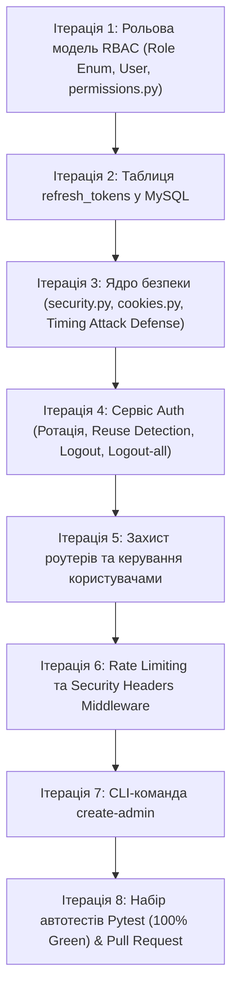

# 🚀 Mission Update 20: Еталонний рівень безпеки та RBAC (Gadget Zone)

> **Мета:** Покрокове впровадження стандарту промислової безпеки (ДЗ-19) у проєкт **Gadget Zone**: серверна ротація токенів у MySQL, захист від повторного використання (Token Reuse Detection), розширена рольова модель (RBAC), захист від Brute-Force та вичерпне тестування.

---

## 🗺 Карта Ітерацій



---

### Ітерація 1: Рольова модель RBAC та права на об'єкти (IDOR Defense)
- [ ] Створити `app/enums.py` з класом `Role(StrEnum)` (`admin`, `manager`, `customer`).
- [ ] Оновити модель `User` у `app/models/user.py`: заміна булевого `is_admin` на `role: Role` (зі збереженням зворотної сумісності через property `is_admin`).
- [ ] Створити `app/core/permissions.py`: функції перевірки прав на рівні окремих сутностей (`can_manage_product`, `can_modify_cart`).
- **Контрольна точка:** Пояснення коду, як роль захищає об'єкти від підміни ID.

---

### Ітерація 2: Сховище Refresh токенів у MySQL (`refresh_tokens`)
- [ ] Створити модель `RefreshToken` у `app/models/refresh_token.py`:
  - `id`: первинний ключ.
  - `token_hash`: унікальний рядок SHA-256 (64 символи).
  - `family_id`: ідентифікатор сесії входу (32 символи, індексований).
  - `user_id`: зовнішній ключ на `users.id` з каскадним видаленням `ondelete="CASCADE"`.
  - `expires_at`, `used_at`, `revoked_at`, `created_at`.
- [ ] Зареєструвати модель у `app/models/__init__.py` та `app/db/init_db.py`.
- **Контрольна точка:** Чому в базі зберігається саме хеш, а не відкритий токен.

---

### Ітерація 3: Оновлення ядра безпеки (`security.py` та `cookies.py`)
- [ ] Оновити `app/core/security.py`:
  - `generate_refresh_token()` через криптографічно стійкий `secrets.token_urlsafe(48)`.
  - `hash_token()` через `hashlib.sha256()`.
  - `hash_password()` та `verify_password()` перевести на `asyncio.to_thread`, щоб не блокувати Event Loop.
  - Додати захист від атак за часом: `DUMMY_HASH`.
- [ ] Оновити `app/core/cookies.py`:
  - Обмеження `Path="/api/v1/auth"`.
  - Прапорці `httponly=True`, `samesite="strict"`, `secure=settings.cookie_secure`.
- **Контрольна точка:** Як влаштований захист від витоку існування користувача (Timing Attack).

---

### Ітерація 4: Сервіс авторизації (Ротація, захист від крадіжки, вихід)
- [ ] Оновити ендпоінти в `app/api/auth.py` (або `app/services/auth_service.py`):
  - `login`: створює нову пару токенів та нову `family_id`.
  - `refresh`: песимістичне блокування `with_for_update()`, перевірка повторного використання (`used_at`), негайне відкликання родини (`_revoke_family`) при спробі крадіжки.
  - `logout`: знаходить токен у базі та відкликає сесію.
  - `logout-all`: відкликає всі активні сесії користувача з усіх пристроїв.
- **Контрольна точка:** Сценарій атаки крадіжки токена та реакція сервера.

---

### Ітерація 5: Захист роутерів та адміністрування користувачів
- [ ] Оновити `app/dependencies.py`:
  - Залежність `require_roles(*roles: Role)`.
  - Типові аліаси: `CurrentUser`, `AdminUser`, `ManagerUser`.
- [ ] Оновити `app/api/admin.py` та `app/api/users.py`:
  - Перевірка, що адмін не може заблокувати або видалити сам себе.
  - При блокуванні користувача (`is_active = False`) — автоматичне відкликання всіх його токенів у базі.
- **Контрольна точка:** Як влаштована ін'єкція залежностей FastAPI для перевірки ролей.

---

### Ітерація 6: Rate Limiting та Security Headers
- [ ] Створити `app/core/rate_limit.py`:
  - In-memory `RateLimiter` на базі ковзного вікна (`deque` міток часу).
  - Помилка HTTP 429 (`TooManyRequestsError`) із заголовком `Retry-After`.
- [ ] Додати захист на `/auth/login` (10/хв), `/register` (5/хв), `/refresh` (30/хв).
- [ ] Додати HTTP Middleware для заголовків безпеки: `X-Content-Type-Options`, `X-Frame-Options`, `Referrer-Policy`, `HSTS`.
- **Контрольна точка:** Тестування перебору паролів (отримання 429).

---

### Ітерація 7: Команда безпечного створення адміністратора (`cli.py`)
- [ ] Створити `app/cli.py` із субкомандою:
  ```bash
  python -m app.cli create-admin --username admin@gadgetzone.com
  ```
- [ ] Безпечне зчитування пароля через `getpass.getpass()`, щоб пароль не світився в терміналі чи логах.
- **Контрольна точка:** Створення першого адміна через консоль.

---

### Ітерація 8: Комплект автотестів Pytest & Відкриття Pull Request
- [ ] Створити `tests/test_dz19_security.py` з повним покриттям:
  - Тест успішної ротації токена.
  - Тест блокування всієї родини при повторному надсиланні старого токена (Reuse Detection).
  - Тест серверного `logout` та `logout-all`.
  - Тест обмеження прав ролей (`customer` vs `manager` vs `admin`).
  - Тест захисту адміна від самоблокування.
  - Тест спрацьовування Rate Limiter (429).
- [ ] Запуск тестів: перевірка 100% успішності (`100% passed`).
- [ ] Запушити гілку `feature/dz19-token-security-rbac` на GitHub і оформити Pull Request.
- **Контрольна точка:** Готове посилання на PR для викладача.
